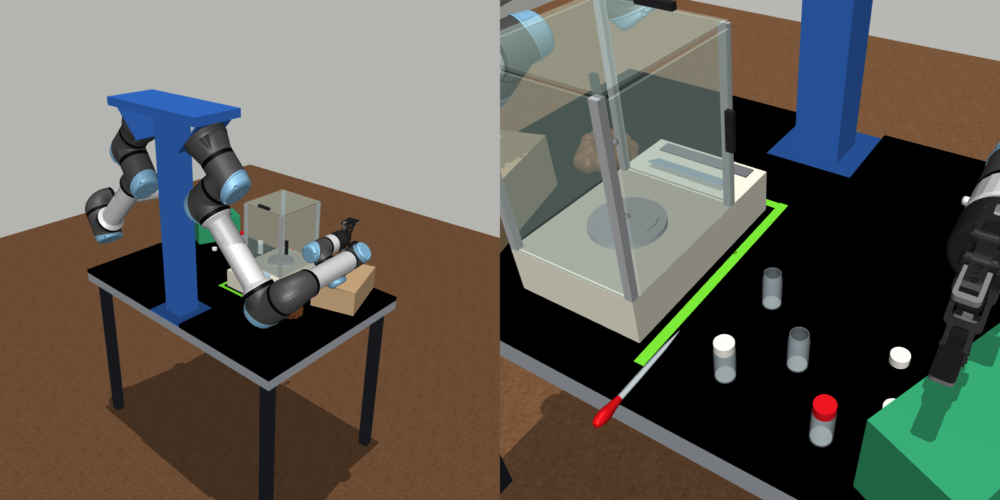
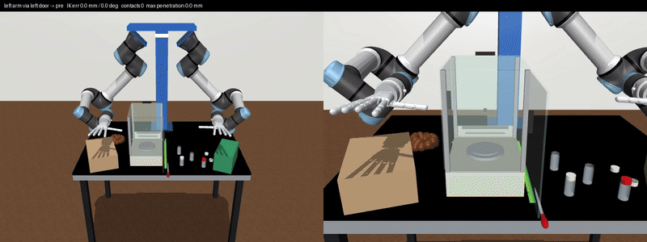

# chem_rl_sim

A MuJoCo version of the vial-weighing bench filmed in
`chem_lab_vial_weighing_trial1_2026-10-08.mov` (2:50–4:10). It contains a Mettler
Toledo ME-class analytical balance with a sliding glass draft shield and a pan
that reports weight, 20 mL glass vials and caps, a Pasteur dropper, and the
nearby clutter. Everything sits on the MaxLab gantry: two UR7e arms with Robotiq
2F-85 grippers bolted to the flanges, or Wuji or Sharpa hands instead. A Gymnasium
environment for the weighing task is included.




## Setup

```bash
git clone --recurse-submodules <this repo>     # or: git submodule update --init
uv sync
export MUJOCO_GL=egl                           # headless rendering
```

The robot comes from the **`third_party/urgantry_sim` git submodule**, which tracks
[leo01110111/urgantry_sim](https://github.com/leo01110111/urgantry_sim). MaxLab
syncs `maxlab/urgantry_sim` from the same repo. It's currently pinned to `46a784a`,
which matches MaxLab's copy file for file. To pick up the latest robot model:

```bash
git submodule update --remote third_party/urgantry_sim && uv sync
```

## Use

```python
import gymnasium as gym
import chem_rl_sim  # registers ChemVialWeighing-v0

env = gym.make("ChemVialWeighing-v0", normalized_actions=True)  # same interface as SimGantryUR7e-v0
obs, info = env.reset(seed=0)        # obs: {'state': (14,), 'image': (224,224,3)}
obs, r, term, trunc, info = env.step(env.action_space.sample())
info["balance_display"]              # '0.0000 g'
```

Useful keyword arguments:
- `hand="wuji"` or `hand="sharpa"` swaps the Robotiq grippers (default,
  `hand="robotiq"`) for 5-finger hands. Each hand sits on a 63 mm adapter cylinder,
  as in urgantry_sim. The action is 14-D with grippers (6 arm joints + 1 gripper
  per arm, gripper 0 = open .. 255 = closed), 52-D with Wuji and 56-D with Sharpa.
- `layout="video"` reproduces the frame at 3:57, with the vial already on the pan.
- `state_mode="proprio+task"` adds the balance reading and the three door
  positions to `state`.
- `start_door_open="right"` starts with the right door open, for a curriculum.

**Task:** put `vial_a` on the pan and close the draft shield. `success` requires
the vial resting upright on the pan, all three doors closed, and the reading
within 1 g of the vial's 20 g.

**Reachability** (checked with the Wuji hands, not yet with the grippers): IK
says the vial has to go in through a side door. The left arm
uses the left door and the right arm the right door; both reach the pan without
contact. Through the top door alone, the best of 12 IK starts still penetrates
the frame by 15–42 mm. The person in the video also went in through the side.



`tools/ik_door_reach.py` reproduces the side-door result. It holds the fingers
horizontal and pointing into the chamber, with the thumb under the palm, and
reports 0 contacts along the whole path for both arms. The point 10 cm along the
fingers has to stay at least 12 cm above the pan. Lower than that, the thumb hits
the pan or balance, and the wrist hits the vials and the boxes beside the balance.

## Tools


| script | what it does |
|---|---|
| `tools/sketchfab_search.py "beaker" ...` | search downloadable Sketchfab models |
| `tools/fetch_objaverse.py <uid> ...` | download a model through Objaverse 1.0, with its license, into `assets/raw/` |
| `tools/glb_contact_sheet.py assets/raw/*.glb --out work/c.png` | render the candidates side by side for triage |
| `tools/mesh_to_mjcf.py <glb> --name N --fit z=0.17 --mass M` | convert to Z up, fit to a measured size, build collision hulls, write an asset folder |
| `tools/make_vial.py` | generate the parametric vial and cap assets |
| `tools/preview_asset.py N` | render the visual mesh beside its collision hulls, on a 1 cm checker |
| `tools/render_overview.py` | render the README image of the whole env → `docs/env.png` |
| `tools/ik_door_reach.py` | IK each arm through its side door to the pan, print errors and contacts → `docs/ik_door_reach.gif` |
| `tools/render_scene.py` | render video frame, sim from the phone's viewpoint, and sim from `top1` → `work/scene_*.png` |

Tests: `PYTEST_DISABLE_PLUGIN_AUTOLOAD=1 uv run pytest -q`. The variable stops the
ROS Jazzy pytest plugins on `PYTHONPATH` from loading.

Asset licenses: see `chem_rl_sim/assets/README.md`. The dropper mesh is CC-BY
(denis98). The Robotiq 2F-85 is mujoco_menagerie's `robotiq_2f85` (04674c8),
copied verbatim into `chem_rl_sim/robotiq_2f85/` (BSD-2-Clause, see its LICENSE)
and mounted by `chem_rl_sim/robot.py`.
