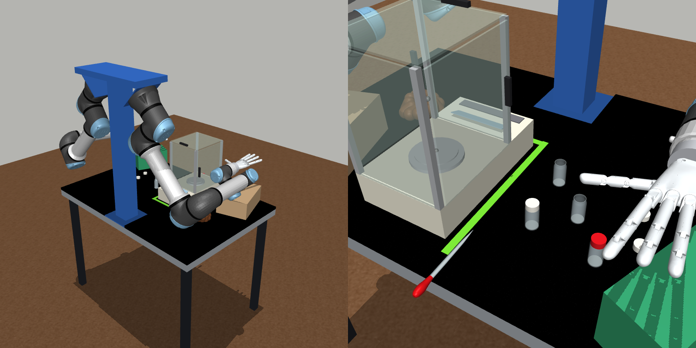
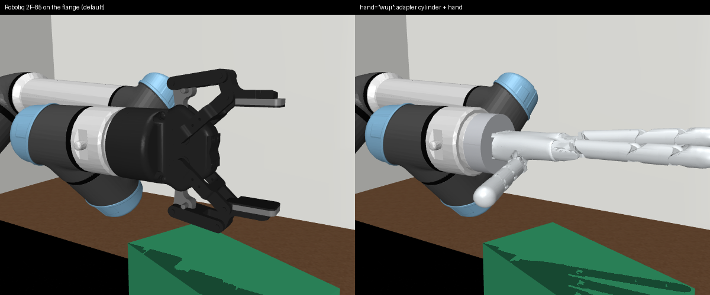
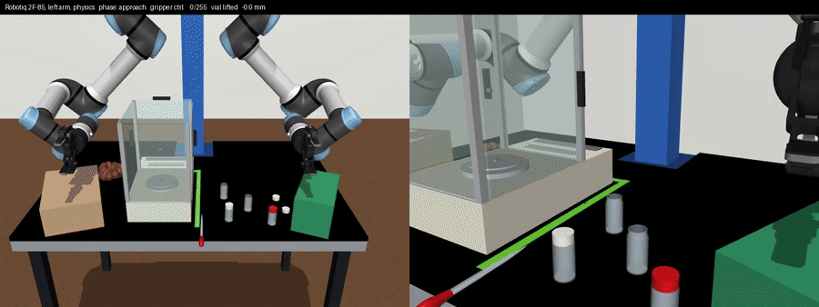
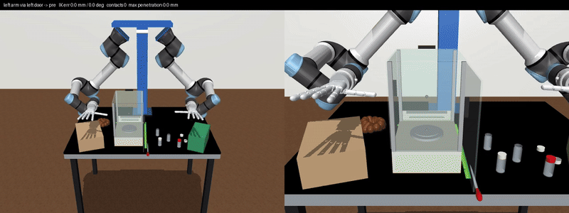
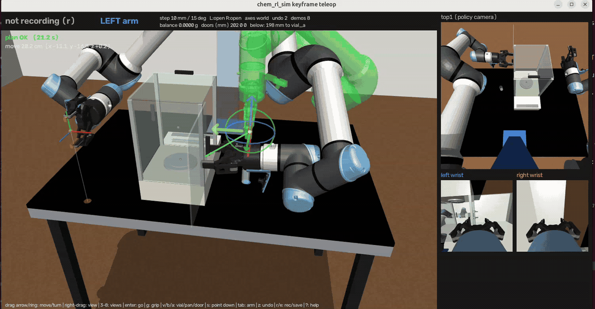
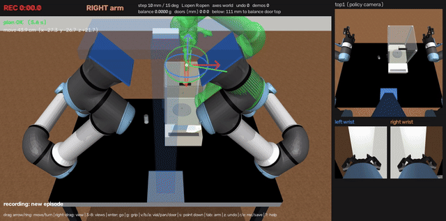

# chem_rl_sim

A MuJoCo version of the vial-weighing bench filmed in
`chem_lab_vial_weighing_trial1_2026-10-08.mov` (2:50–4:10). It contains a Mettler
Toledo ME-class analytical balance with a sliding glass draft shield and a pan
that reports weight, 20 mL glass vials and caps, a Pasteur dropper, and the
nearby clutter. Everything sits on the MaxLab gantry: two UR7e arms with Robotiq
2F-85 grippers bolted to the flanges, or Wuji or Sharpa hands instead. A Gymnasium
environment for the weighing task is included.



The default end effector is a Robotiq 2F-85 bolted straight onto each UR7e
flange. `hand="wuji"` or `hand="sharpa"` puts the 5-finger hands back, on their
adapter cylinder.



A scripted top-down pick under physics (IK waypoints, position servos, gripper
contacts), from `tools/gripper_pick.py`. The left gripper lifts `vial_a` 119 mm
(120 mm commanded) and it ends tilted 0.2°.




## Setup

```bash
git clone --recurse-submodules <this repo>     # or: git submodule update --init
uv sync
export MUJOCO_GL=egl                           # headless rendering
```

The robot comes from the **`third_party/urgantry_sim` git submodule**, which tracks
[leo01110111/urgantry_sim](https://github.com/leo01110111/urgantry_sim). MaxLab
syncs `maxlab/urgantry_sim` from the same repo. It's currently pinned to `46a784a`,
which matches MaxLab's copy file for file. To pick up the latest robot model:

```bash
git submodule update --remote third_party/urgantry_sim && uv sync
```

## Use

```python
import gymnasium as gym
import chem_rl_sim  # registers ChemVialWeighing-v0

env = gym.make("ChemVialWeighing-v0", normalized_actions=True)  # same interface as SimGantryUR7e-v0
obs, info = env.reset(seed=0)        # obs: {'state': (14,), 'image': (224,224,3)}
obs, r, term, trunc, info = env.step(env.action_space.sample())
info["balance_display"]              # '0.0000 g'
```

Useful keyword arguments:
- `hand="wuji"` or `hand="sharpa"` swaps the Robotiq grippers (default,
  `hand="robotiq"`) for 5-finger hands. Each hand sits on a 63 mm adapter cylinder,
  as in urgantry_sim. The action is 14-D with grippers (6 arm joints + 1 gripper
  per arm, gripper 0 = open .. 255 = closed), 52-D with Wuji and 56-D with Sharpa.
- `layout="video"` reproduces the frame at 3:57, with the vial already on the pan.
- `state_mode="proprio+task"` adds the balance reading and the three door
  positions to `state`.
- `start_door_open="right"` starts with the right door open, for a curriculum.

**Task:** put `vial_a` on the pan and close the draft shield. `success` requires
the vial resting upright on the pan, all three doors closed, and the reading
within 1 g of the vial's 20 g.

**Reachability** (checked with the Wuji hands, not yet with the grippers): IK
says the vial has to go in through a side door. The left arm
uses the left door and the right arm the right door; both reach the pan without
contact. Through the top door alone, the best of 12 IK starts still penetrates
the frame by 15–42 mm. The person in the video also went in through the side.



`tools/ik_door_reach.py` reproduces the side-door result. It holds the fingers
horizontal and pointing into the chamber, with the thumb under the palm, and
reports 0 contacts along the whole path for both arms. The point 10 cm along the
fingers has to stay at least 12 cm above the pan. Lower than that, the thumb hits
the pan or balance, and the wrist hits the vials and the boxes beside the balance.

## Teleop data collection (keyframes: mouse and keyboard)

This collector needs only a mouse, a keyboard and a screen. There's no camera and no GPU
model. You drag a target for a gripper in a 3D view while the sim is frozen. A ghost of
the arm shows the planned motion, colored by what it would do. Press Enter and the arm
runs there under physics while the episode records.

```bash
uv sync --extra teleop
env -u PYTHONPATH uv run python -m chem_rl_sim.teleop.keyframe_app --dataset weigh_vial
```



*Using it by hand (4 s, real time).* The ghost is red while the move would fail (here an
IK jump). Drag the target with the triad until the ghost turns green, then press Enter and
the arm runs there.



**Why keyframes.** Flying a gripper live with keys gives jerky, one-axis-at-a-time motion
and hesitant pauses, and a BC policy learns both. Here you pick the goal and the robot
fills in the motion. Each move is a min-jerk Cartesian path, solved by IK at the control
rate. Time spent aiming isn't simulated, so the demos have no idle stretches.

**Ghost colors.**
- **Green:** the plan is fine.
- **Orange:** the arm, or the object it holds, touches something movable: a door, the
  pan or a prop. That's how doors get slid, so it's allowed.
- **Red:** IK can't reach the target, or the path hits static geometry or the other
  arm. Enter refuses a red plan; a second Enter runs it anyway.

The check carries a held vial along with the gripper. Contacts that already exist at the
start of a move don't count against it. Planning takes 3–8 ms, so the ghost follows the
mouse live.

**On-screen aids.**
- **Routing:** when the straight path would touch something, the planner tries going up,
  across and down instead. The status line then says "via above".
- **Path:** the planned path is drawn, and an X marks the first spot where a plan touches
  something.
- **Gap below:** the line under the target ends on whatever is beneath it. The top bar
  gives that gap, measured from a held vial's base, such as "below: 122 mm to balance pan".
- **Move distance:** while you edit a target, the top bar shows how far it is from the
  gripper, per axis.

**Controls.** Press `?` in the window for the full list.

| input | does |
|---|---|
| drag a triad arrow / ring | move the active target along that axis / turn it about that axis (red x, green y, blue z; `w` switches world / gripper axes) |
| left drag elsewhere / shift + drag / ctrl + drag | move the active target horizontally / up and down / turn it. Left drag never moves the view |
| right drag, middle drag, wheel (or `-` `=`) | orbit, pan, zoom the view |
| `n` `m` / `t` `y` | orbit left / right, tilt up / down (for trackpads) |
| `3`–`7`, `p` | preset views: operator, left side, right side, top, back; `p` cycles them |
| `8` | close-up on the active gripper's target |
| F11 or shift+`f` (or `--fullscreen`) | fullscreen on / off; the window can also be resized or maximized |
| arrows, PgUp/PgDn; `j l` `i k` `u o` | nudge by the step; yaw, tilt, roll by the step angle. `[` `]` change the step (2 mm/2° .. 3 cm/45°) |
| `tab`, `1`, `2` | switch arm |
| `v` / `b` / `a` | snap above `vial_a`, top-down / above the pan / above the top door's handle, fingers across it. Press again once the gripper is there to go to grasp / place height |
| `s` | point the gripper straight down, keeping its position and heading |
| `h` / `c` | target back to the start pose / to where the gripper is now |
| Enter | run the plan |
| `g` | close or open the active gripper (ramped, then waits for the fingers to stop) |
| `f` | follow mode: arms track their targets live while you drag, for pushing things |
| `z`, Backspace | undo the last motion: the sim, the targets and the recording |
| `r` / `e` / `d` / `x` | new episode (reset and record) / save / discard / delete the last saved demo |
| `0`, `q` | reset the scene without recording, quit |

An episode saves itself when the env reports success, or after `--max-episode-s` (300 s)
of recorded motion. `--playback 2` runs the motion twice as fast on screen; the recorded
data is the same.

**A route that works** (`chem_rl_sim/teleop/keyframe_script.py` runs it, and
`tests/test_keyframe.py` checks that it reaches success with every plan green). It uses
snaps and the automatic routing, plus one drag per door slide:
1. **Open the top door.** With the right arm (`tab`), press `a`, Enter, `a`, Enter, `g`.
   Drag the green arrow back by 20 cm, Enter, `g`, `h`, Enter.
2. **Pick the vial.** With the left arm, press `v`, Enter, `v`, Enter, `g`.
3. **Place it.** Press `b`, Enter. This is routed up and in through the open top. Then
   `b`, Enter, `g`.
4. **Close the door.** `h`, Enter for the left arm. Then with the right arm: `a`, Enter,
   `a`, Enter, `g`, drag the green arrow forward until the door is shut, Enter, `g`. The
   episode saves itself on success.

The door snap grasps the handle 16 mm above its centre. Grasping lower lets the finger
pads rest on the glass, and opening the gripper then drags the door back open by 2–4 cm.

**Servo targets.** The UR position servos sag about 10 mrad per joint under gravity,
which is about 9 mm at the tool. So the command is `q + gravity torque / kp`, which
includes a held vial's weight, and the arm settles on the keyframe instead of below it.
The recorded action is that command, which is exactly what went to the env.

**Data.** The output is `data/teleop/<dataset>.hdf5`, in the same OGPO/robomimic layout
as below (`recorder.py`): 14-D actions normalized to [-1, 1], `top1_image`, the wrist
images, eef poses and `object`. `operator/` holds the keyframe goals:
- `goal_pos` (T, 2, 3) and `goal_quat` (T, 2, 4)
- `segment`: one id per keyframe, gripper action or follow burst
- `kind`: 0 move, 1 grip, 2 follow

`tools/keyframe_demo.py` renders the GIF above from the real window.

## Teleop data collection (WiLoR hand tracking)

Your hands under a camera drive both arms. The left hand drives the left arm and the
right hand the right arm. Pinching thumb and index together closes that arm's Robotiq
gripper; with `--hand wuji`, your fingers are retargeted onto the Wuji fingers. You
watch the scene from `top1`, the policy camera, and every episode lands in an
OGPO-format HDF5.

```bash
uv sync --extra teleop
env -u PYTHONPATH uv run python -m chem_rl_sim.teleop --dataset weigh_vial               # RealSense, Robotiq
env -u PYTHONPATH uv run python -m chem_rl_sim.teleop --dataset weigh_vial --hand wuji   # Wuji hands
env -u PYTHONPATH uv run python -m chem_rl_sim.teleop --source 0 --hfov 70                # a webcam
```

**Scene.** The collector defaults to `--layout weigh` with no clutter: just the balance
and `vial_a`, nothing the policy has to learn to ignore. `--layout task --clutter` gives
the full bench from the video.

**Camera placement.** By default (`--view selfie`) the camera sits in front of you and
faces you, for example on top of the monitor. `--view overhead` is for a camera above your
hands looking down, with the top of the image pointing away from you. Either way, moving
your hand right, forward (away from you) or up moves the gripper right, forward or up as
seen from `top1`. Turning your hand turns the gripper about the same axis. Only motion
*deltas* are used, so the camera's exact position doesn't matter. Use `--camera-pitch`
if the camera is tilted, and `--rotate` if its image is sideways. In selfie view,
forward and back come from WiLoR's monocular depth, which is the noisiest axis.

**Voice commands.** Say each command on its own, with a short pause before and after.
Every command also has a key on the window.

| say | key | does |
|---|---|---|
| `start` / `record` | `s` | reset the scene, start an episode, engage both arms |
| `stop` / `save` | `e` | save the episode (the success flag comes from the env) |
| `discard` / `cancel` | `d` | drop the episode |
| `delete` | `x` | delete the last saved episode |
| `pause` (or just "P") / `resume` | space | freeze the sim and recording; `resume` re-anchors your hands wherever they are now |
| `go` / `hold` | `g` / `h` | engage / release both arms (the clutch) |
| `left go`, `left hold`, `right go`, `right hold` | `1` / `2` | one arm |
| `reset` | `r` | discard and reset the scene |
| `quit` | `q`, Esc | quit (an episode in progress is saved) |

An engaged arm follows your hand; a released arm holds its pose. A hand that drops out
of view holds too, and picks up where it was when it reappears. An episode also ends
and saves itself when the env reports success, or after `--max-episode-s` (180 s).

**Rate.** Observations and actions are both recorded at 20 Hz (`--hz`), on one clock.
WiLoR runs at the camera's frame rate (30 Hz) in a separate process in the `wilor`
conda env (`~/WiLoR`), and each tick uses its newest result. On the dev machine the
camera-to-action latency was 25–40 ms median and under 60 ms max.

**Data.** The output is `data/teleop/<dataset>.hdf5` in robomimic's layout, which is what
OGPO's loader reads:

- **Actions:** `data/demo_k/actions` holds 14-D actions (52-D with Wuji), normalized to
  [-1, 1].
- **Rewards and dones:** `rewards` and `dones` are sparse success flags.
- **Observations:** `obs/` and `next_obs/` hold `top1_image` (224²) and `joint_pos`,
  plus `robot{0,1}_eef_pos`/`_eef_quat`/`_gripper_qpos` for the two arms, and `object`
  (vial pose, balance reading, doors).
- **Operator:** `operator/` holds your raw hand keypoints, so you can re-retarget later
  without re-running WiLoR.

`chem_rl_sim/teleop/recorder.py` lists every key and gives an OGPO `TASK_CONFIG` entry.

### What it needs to run in real time

Measured on the dev box (RTX 5090, Threadripper 9985WX). Anything past that is an
estimate, and is marked as one.

| | measured | minimum (estimate) |
|---|---|---|
| GPU | WiLoR 19 ms/frame fp16 (21 ms fp32), 2.2 GB VRAM incl. CUDA context; MuJoCo EGL rendering is negligible | NVIDIA with ≥ 4 GB VRAM that runs WiLoR in ≤ 35 ms, so that perception stays above 20 Hz. Roughly an RTX 3070 / 4060 Ti class card or better (untested). |
| CPU | worker ~0.9 core, app ~0.2 core (sim 2.5 ms + IK + render ≈ 5 ms of each 50 ms tick) | 4 modern cores |
| RAM | worker 2.8 GB, app 1.0 GB; an episode buffers ~3 MB/s of images until saved (~0.5 GB for 3 min) | 8 GB free |
| Disk | 86 MB per minute of demonstration | ~5 GB per hour of data |
| Camera | Intel RealSense (tested with a D415 at 640×480, 30 fps; intrinsics are read from the device) or any UVC webcam (`--source N --hfov <deg>`) | 30 fps, facing you (or overhead with `--view overhead`) |
| Mic | any USB mic through PipeWire/ALSA (Vosk small-en runs offline on the CPU) | — |
| Software | Linux + NVIDIA driver/CUDA for the `wilor` conda env; this repo's uv env; `spd-say` for spoken confirmations (optional) | — |

## Tools


| script | what it does |
|---|---|
| `tools/sketchfab_search.py "beaker" ...` | search downloadable Sketchfab models |
| `tools/fetch_objaverse.py <uid> ...` | download a model through Objaverse 1.0, with its license, into `assets/raw/` |
| `tools/glb_contact_sheet.py assets/raw/*.glb --out work/c.png` | render the candidates side by side for triage |
| `tools/mesh_to_mjcf.py <glb> --name N --fit z=0.17 --mass M` | convert to Z up, fit to a measured size, build collision hulls, write an asset folder |
| `tools/make_vial.py` | generate the parametric vial and cap assets |
| `tools/preview_asset.py N` | render the visual mesh beside its collision hulls, on a 1 cm checker |
| `tools/render_overview.py` | render the README image of the whole env → `docs/env.png` |
| `tools/ik_door_reach.py` | IK each arm through its side door to the pan, print errors and contacts → `docs/ik_door_reach.gif` |
| `tools/gripper_pick.py` | scripted Robotiq pick of `vial_a` under physics, plus the wrist close-up → `docs/gripper_pick.gif`, `docs/gripper_mount.png` |
| `tools/keyframe_demo.py` | drive the keyframe teleop window with the scripted operator through the whole task → `docs/keyframe_teleop.gif` |
| `tools/render_scene.py` | render video frame, sim from the phone's viewpoint, and sim from `top1` → `work/scene_*.png` |

Tests: `PYTEST_DISABLE_PLUGIN_AUTOLOAD=1 uv run pytest -q`. The variable stops the
ROS Jazzy pytest plugins on `PYTHONPATH` from loading.

Asset licenses: see `chem_rl_sim/assets/README.md`. The dropper mesh is CC-BY
(denis98). The Robotiq 2F-85 is mujoco_menagerie's `robotiq_2f85` (04674c8),
copied verbatim into `chem_rl_sim/robotiq_2f85/` (BSD-2-Clause, see its LICENSE)
and mounted by `chem_rl_sim/robot.py`.
